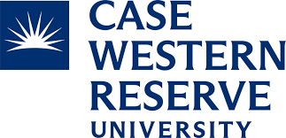
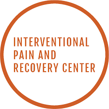

[RESEARCH · CLINICAL · COMMUNITY]{.eyebrow}

## Where have I worked?

My path brings together mental health research, patient care, and a commitment to accessible, inclusive science.

::: {.career-timeline aria-label="Research and clinical experience, most recent first"}

::: {.timeline-entry}
::: {.timeline-date}
Winter 2026 – Present
:::
::: {.timeline-card}
### Clinical Research Assistant · ASTRA

{.institution-logo .institution-logo-wide}

[The Ohio State University Wexner Medical Center]{.timeline-organization}

Department of Psychiatry and Behavioral Health  
Anxiety Sensitivity Treatment to Reduce Anxiety in Alzheimer's (ASTRA)  
R01AG077569  
PI: Nicholas Allan, PhD
:::
:::

::: {.timeline-entry}
::: {.timeline-date}
Spring 2025 – Present
:::
::: {.timeline-card}
### Research Project Coordinator · ARC

{.institution-logo .institution-logo-wide}

[The Ohio State University Wexner Medical Center]{.timeline-organization}

Department of Psychiatry and Behavioral Health  
Advanced Resilience and Coping Study (ARC)  
R01MH136286  
PIs: Melanie Bozzay, PhD, and Nicholas Allan, PhD
:::
:::

::: {.timeline-entry}
::: {.timeline-date}
Fall 2024 – May 2025
:::
::: {.timeline-card}
### Graduate Research Assistant

[Louis Stokes Cleveland VA Medical Center]{.timeline-organization}

Depression and suicide prevention research  
PI: James Overholser, PhD
:::
:::

::: {.timeline-entry}
::: {.timeline-date}
Fall 2023 – Winter 2024
:::
::: {.timeline-card}
### Graduate Student Assistant

{.institution-logo}

[Case Western Reserve University School of Medicine]{.timeline-organization}

Office of Diversity, Equity, and Inclusive Excellence  
Supervisor: Adrianne Fletcher, PhD
:::
:::

::: {.timeline-entry}
::: {.timeline-date}
Summer 2021 – Fall 2022
:::
::: {.timeline-card}
### Clinical Senior Team Member

{.institution-logo}

[Interventional Pain & Recovery Center]{.timeline-organization}

:::
:::

::: {.timeline-entry}
::: {.timeline-date}
Fall 2019 – Fall 2020
:::
::: {.timeline-card}
### Research Assistant

{.institution-logo}

[Baylor University]{.timeline-organization}

Water Quality and Ecotoxicology Lab  

PI: Bryan Brooks, PhD
:::
:::

::: {.timeline-entry}
::: {.timeline-date}
Spring 2018 – Spring 2021
:::
::: {.timeline-card}
### Senior Intern

[Meyers Clinic]{.timeline-organization}

:::
:::

:::

[View my CV](cv.html?v=site-20261026-bold){.btn .btn-primary}
