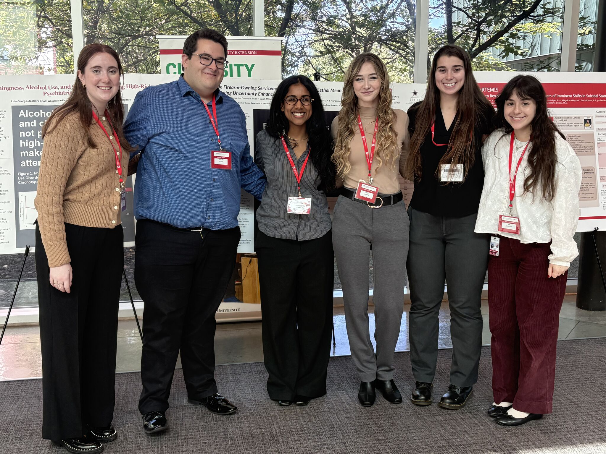

::: {.photo-gallery}
::: {.photo-card}
{fig-alt="Presenting a research poster at the National Academy of Neuropsychology conference in Chicago, Illinois." loading="lazy"}
:::

::: {.photo-card}
{fig-alt="Presenting a research poster at the Computational Psychiatry Conference in New Haven, Connecticut." loading="lazy"}
:::

::: {.photo-card}
.](assets/suicide_research_symposium.jpeg){fig-alt="Group photo at the S.T.R.I.V.E. office for the virtual Suicide Research Symposium." loading="lazy"}
:::

::: {.photo-card}
{fig-alt="Group photo at the Suicide Prevention Conference at The Ohio State University." loading="lazy"}
:::
:::
